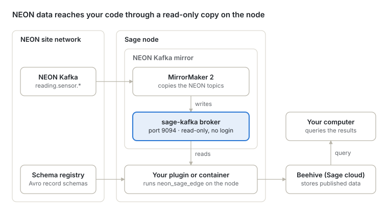

# Using the NEON Kafka Mirror on Sage

## What is the Sage NEON Kafka mirror?

The Sage NEON Kafka mirror gives a Sage node a local, read-only copy of a NEON site's real-time sensor streams. You can read those streams with a few lines of Python, explore them in a notebook, and build Sage plugins that turn them into published measurements.

NEON (the National Ecological Observatory Network) streams its instrument readings through Apache Kafka. The mirror copies selected topics from NEON's Kafka into a small Kafka broker that runs next to the Sage node, so readers never touch NEON's own systems and need no NEON account.

## Why use it?

The mirror brings NEON's measurements to the place where Sage computes, so research code can work with them as they arrive.

- **Live NEON data at the edge.** Readings reach the node shortly after they're taken, from 20 Hz wind measurements to slower soil and weather readings, so a plugin can work with them right where they're collected.
- **A whole ecosystem in one place.** At H01B, for example, the mirror carries:
  - Soil moisture and temperature (Acclima TDR-315N, Sentek EnviroSCAN), and soil heat flux (Hukseflux HFP01SC)
  - Sunlight and radiation: net radiation (Hukseflux NR01), solar radiation (Kipp & Zonen CMP22, Delta-T SPN1) and photosynthetically active radiation (Kipp & Zonen PQS1, LI-COR LI-191R)
  - Precipitation (Belfort AEPG-600M, OTT Pluvio2)
  - Air temperature, humidity and pressure (Vaisala HMP155, platinum resistance thermometers, Vaisala PTB330), and surface temperature (Apogee SI-111)
  - Carbon dioxide, water vapor and their isotopes (Vaisala GMP343, LI-COR LI-850 and LI-7200, Picarro analyzers)
  - Wind in two and three dimensions (Gill WindObserver II, Campbell Scientific CSAT3B)
- **Science as it happens.** With the data arriving live, a plugin can, for example:
  - Track how fast the soil dries after rain, from soil moisture and precipitation together.
  - Follow the surface energy balance through the day, from net radiation, soil heat flux and surface temperature.
  - Spot an approaching storm from falling pressure, rising wind and the first rain.
  - Compute eddy covariance fluxes of heat, water vapor and carbon dioxide from the 20 Hz sonic anemometer and gas analyzer, starting from NEON's open-source [eddy4R](https://github.com/NEONScience/eddy4R) code. These are fast first estimates that complement NEON's quality-controlled products.
- **AI next to the instruments.** Sage nodes built on NVIDIA Jetson Thor carry a Blackwell GPU with 128 GB of memory, enough to run machine learning models on the streams as they arrive. Some ideas:
  - Catch failing or drifting sensors the moment their readings turn unusual, with anomaly detection.
  - Forecast the next hours of soil moisture, temperature or rain with a time-series model.
  - Fill gaps in any record, from soil moisture to fluxes, as soon as they appear.
  - Combine NEON data with the node's cameras: capture images when a storm arrives, or relate the vegetation the cameras see to soil moisture and sunlight.
- **NEON and Sage side by side.** A plugin on the node can combine NEON's instruments with the node's own cameras, microphones and sensors.
- **Derived data for everyone.** Plugins can turn raw streams into compact products, such as 30-minute averages, daily soil water summaries or fluxes, and publish them to Sage's cloud, where anyone can query them.

## Capabilities

With the mirror and the neon_sage_edge client, a Sage user can:

- Read any of the site's NEON sensor topics (`reading.sensor.*`) from a plugin or container on the node
- Get NEON's Avro records back as ordinary tables, decoded through NEON's schema registry
- Select data by when each reading was taken, rather than by when it reached Kafka
- Explore the streams interactively in a ready-made notebook
- Build plugins that compute new data products from the streams, and schedule them as Sage jobs
- Query what those plugins publish from anywhere, with code or in the Sage portal

## How it works

MirrorMaker 2 copies NEON's `reading.sensor.*` topics into a Kafka broker on the node, and everything else reads from that copy.

Readers connect to port 9094 without a login and can only read. Their code runs on the node, as a plugin or in a container. Plugins and notebooks decode NEON's Avro records through NEON's schema registry. Plugins publish their results to Beehive, Sage's cloud data store, where `sage_data_client` queries them.

## NEON sensors on Sage Nodes

The NEON Kafka mirror runs on these Sage nodes, with more on the way.

| Node | Kafka access |
| --- | --- |
| [H01B](https://portal.sagecontinuum.org/nodes/H01B) | Available |
| [H03C](https://portal.sagecontinuum.org/nodes/H03C) | Coming soon |
| [H03B](https://portal.sagecontinuum.org/nodes/H03B) | Coming soon |
| [H036](https://portal.sagecontinuum.org/nodes/H036) | Coming soon |

The sensor lists for H03C, H03B and H036 will be added here once their mirrors are online.

### H01B

These are the NEON sensor topics that carry data on the mirror at node H01B, with the instrument each one comes from, as described in NEON's schema registry.

| Topic | Sensor |
| --- | --- |
| `reading.sensor.aepg600m_heated` | Belfort AEPG-600M Precipitation Gauge - Heated |
| `reading.sensor.cmp22` | Kipp & Zonen CMP22 Pyranometer |
| `reading.sensor.cr1000x` | Campbell CR1000X Data Logger |
| `reading.sensor.csat3b` | Campbell Scientific CSAT3B 3D Wind Sensor |
| `reading.sensor.dualfan` | NEON Dual-Fan Aspirated Shield Fan Honeycomb stack |
| `reading.sensor.enviroscan` | Sentek EnviroSCAN Current Probe Interface |
| `reading.sensor.g2131i_raw` | Picarro G2131-i Isotope and Gas Concentration Analyzer |
| `reading.sensor.gmp343` | Vaisala CARBOCAP GMP343 Carbon Dioxide Probe |
| `reading.sensor.grape` | NEON Grape Data Logger |
| `reading.sensor.hfp01sc` | Hukseflux HFP01SC Heat Flux Plate |
| `reading.sensor.hmp155` | Vaisala HMP155 Humidity and Temperature Probe |
| `reading.sensor.l2130i_raw` | Picarro L2130-i Isotope Water Analyzer |
| `reading.sensor.li191r` | LI-COR LI-191R Line Quantum Sensor |
| `reading.sensor.li7200_raw` | LI-COR Biosciences LI-7200 Enclosed CO2/H2O Gas Analyzer |
| `reading.sensor.li850` | LI-COR LI-850 CO2 and H2O Gas Analyzer |
| `reading.sensor.mcseries` | ALICAT MC-Series Gas Mass Flow Controllers |
| `reading.sensor.mti300ahrs` | XSense MTi-300 AHRS Accelerometer |
| `reading.sensor.mwseries` | ALICAT MW-Series Low Pressure Drop Gas Mass Flow Meters |
| `reading.sensor.nr01` | Hukseflux NR01 Net Radiometer |
| `reading.sensor.picarro3way` | Picarro L2130i 3 way valve |
| `reading.sensor.pluvio_raw` | OTT Pluvio2 |
| `reading.sensor.pqs1` | Kipp & Zonen PQS1 Photosynthetically Active Radiation (PAR) |
| `reading.sensor.pressuretransducer` | Generic Pressure Transducer |
| `reading.sensor.prt` | 100 Ohm Platinum Resistance Thermometer |
| `reading.sensor.ptb330a` | Vaisala BAROCAP PTB330 Digital Barometer |
| `reading.sensor.pump` | DAC output for vacuum pump speed control |
| `reading.sensor.si111` | Apogee SI-111 Infrared Radiometer |
| `reading.sensor.solenoid` | Solenoid with 8 digital outputs |
| `reading.sensor.spn1` | Delta-T Devices SPN1 Sunshine Pyranometer |
| `reading.sensor.t7610_raw` | Comet T7610 Remote Thermometer Hygrometer Barometer |
| `reading.sensor.tdr315n_raw` | Acclima TDR-315N |
| `reading.sensor.windobserverii` | Gill WindObserver II 2D Ultrasonic Anemometer |

## How to get started

Each step points to the repository or Sage document that covers it in detail.

1. **Get access to a node that runs the mirror.** Request node access in the Sage portal's [account page](https://portal.sagecontinuum.org/account/access). Choose a node with Kafka access from the table above, and ask a Sage system administrator for the schema registry's address.
2. **Explore the data.** The [neon_sage_edge](https://github.com/sagecontinuum/neon_sage_edge) README shows how to install the client and read your first messages, and its `mirror-explorer` notebook walks through the topics, the latest readings and what arrived recently. Run both in a container on the node (see [Things to know](#things-to-know) below).
3. **Build a plugin.** Start from [neon-csat3b-average](https://github.com/sagecontinuum/neon-csat3b-average), a working plugin that reads the mirror and publishes 30-minute wind averages. Its README explains each part. New plugins start from the Sage app template, [cookiecutter-sage-app](https://github.com/waggle-sensor/cookiecutter-sage-app).
4. **Run and schedule it.** Test it on the node with `pluginctl`, register it in the Sage portal, and schedule it as a job. The [Developer quick reference](https://sagecontinuum.org/docs/reference-guides/dev-quick-reference) covers each step.
5. **Use the results.** Query what your plugin publishes with [sage-data-client](https://github.com/sagecontinuum/sage-data-client), or browse it in the portal's [Query Browser](https://portal.sagecontinuum.org/query-browser).

## Implementation

The mirror, the Python client and an example plugin each live in their own repository. Most readers only need the client.

| Repository | What it is | You need it to |
| --- | --- | --- |
| [sage-neon-broker](https://github.com/sagecontinuum/sage-neon-broker) | The NEON Kafka mirror on the node. It copies every `reading.sensor.*` topic from NEON and serves it read-only on port 9094. | Set up and run the mirror on a node (Sage system administrators only) |
| [neon_sage_edge](https://github.com/sagecontinuum/neon_sage_edge) | A read-only Python client (release 0.1.0). It lists topics, reads messages by time window, and decodes NEON's Avro records through the schema registry. It also holds the `mirror-explorer` notebook. | Read or explore NEON data, or build a plugin |
| [neon-csat3b-average](https://github.com/sagecontinuum/neon-csat3b-average) | An example Sage plugin. Every 30 minutes it publishes the average of the CSAT3B sonic anemometer's three wind speeds. | Start your own plugin from a working one |

:::note

sage-neon-broker is set up and run by a Sage system administrator. It isn't meant for regular Sage users: to work with NEON data, you only need the neon_sage_edge client and access to a node that runs the mirror.

:::

## Things to know

The mirror behaves a little differently from other data sources on Sage. These points save the most time.

- **Code that reads the mirror runs on the node.** The mirror sends every client back to `localhost:9094`, so it can only be read from the node itself: from a plugin, or from a container started with `--network host`. Sage nodes don't allow running programs outside containers.
- **It's read-only and needs no login.** Anyone on the node can read the `reading.sensor.*` topics, and nothing can write to them.
- **Records are Avro.** Decoding them needs NEON's schema registry: its URL, plus its IP address if the node can't resolve the name.
- **Each reading has two times.** `readout_time`, inside the record, is when the reading was taken, and the Kafka timestamp is when it reached Kafka. Select data by `readout_time`. The gap between the two shows how long delivery took.
- **Data arrives in batches.** NEON often delivers readings about a minute at a time, so read a few minutes beyond the window you need.
- **Streams are big.** At 20 Hz, one stream produces 36,000 readings every 30 minutes, so read time windows rather than whole topics.

## Troubleshooting

Most problems come down to an address, a topic name or a missing registry setting.

| Symptom | Likely cause | Fix |
| --- | --- | --- |
| A topic you expect isn't on the mirror | Only topics matching `reading.sensor.*` are copied, and names must match in full | Check the exact name with `reader.topics()`, and ask a Sage system administrator if a NEON topic is missing |
| Values come back as bytes, and `expand_json` adds no columns | The records are Avro and no schema registry is set | Set the registry URL and `value_format="avro"` |
| A note says the registry can't be reached | The node can't resolve the registry's name | Set the registry's IP with `ip=` or `SCHEMA_REGISTRY_IP` |
| Connecting from your own computer fails or hangs | The mirror only serves code on the node: it sends every client back to `localhost:9094` | Run your code on the node, in a container or as a plugin with the `socat` relay |
| A read returns fewer readings than expected | It stopped at `max_messages`, and a note says so | Raise `max_messages`, or read a shorter window |

For anything else, head over to the [Contact us](https://sagecontinuum.org/docs/contact-us) page.

## References

**Source code**

- [sage-neon-broker](https://github.com/sagecontinuum/sage-neon-broker): the mirror itself, for Sage system administrators
- [neon_sage_edge](https://github.com/sagecontinuum/neon_sage_edge): the Python client and the [mirror-explorer notebook](https://github.com/sagecontinuum/neon_sage_edge/blob/main/notebooks/mirror-explorer.ipynb)
- [neon-csat3b-average](https://github.com/sagecontinuum/neon-csat3b-average): the example plugin
- [cookiecutter-sage-app](https://github.com/waggle-sensor/cookiecutter-sage-app): the Sage app template

**Sage documentation**

- [Developer quick reference](https://sagecontinuum.org/docs/reference-guides/dev-quick-reference): node access, `pluginctl`, registering apps, job files and data queries
- [pluginctl](https://sagecontinuum.org/docs/reference-guides/pluginctl) and [sesctl](https://sagecontinuum.org/docs/reference-guides/sesctl) reference guides
- [Creating a job](https://github.com/waggle-sensor/edge-scheduler/blob/main/docs/sesctl/tutorial_createjob.md): the job file format
- [Node access](https://portal.sagecontinuum.org/account/access) and the [Query Browser](https://portal.sagecontinuum.org/query-browser) in the Sage portal
- [sage-data-client](https://github.com/sagecontinuum/sage-data-client) and [pywaggle](https://github.com/waggle-sensor/pywaggle)

**Background**

- [NEON](https://www.neonscience.org), the National Ecological Observatory Network
- [Campbell Scientific CSAT3B](https://www.campbellsci.com/csat3b), the sonic anemometer behind the example plugin
