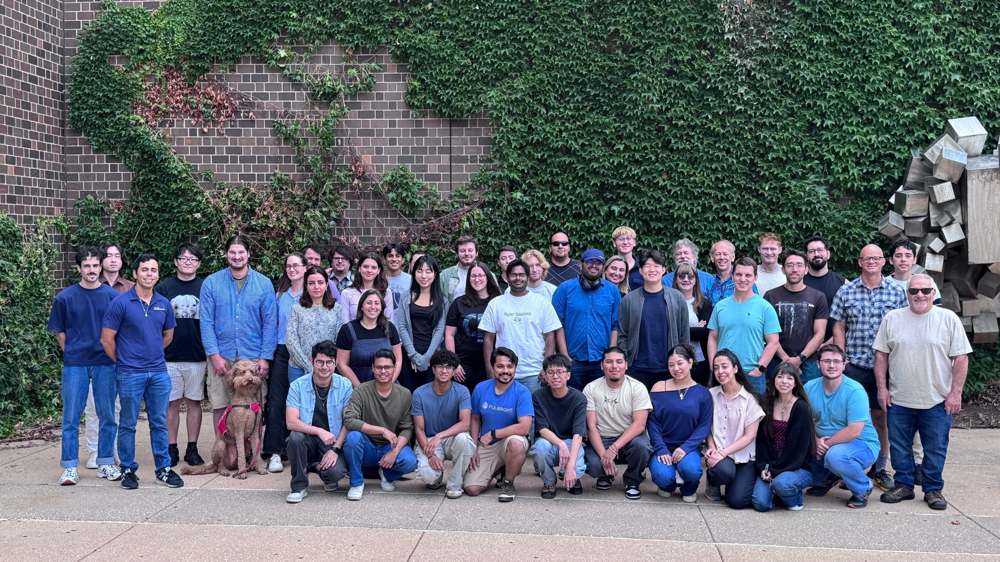

import AttendeeMap from './components/summer-camp-2026/AttendeeMap'
import ProjectGrid from './components/summer-camp-2026/ProjectGrid'
import {ScheduleStrip, ThemeChart, LevelChart, CampStats, SkillsChart, AgreementChart, Quotes} from './components/summer-camp-2026/CampCharts'
import PhotoGallery from '@site/src/pages/PhotoGallery'

From July 19 to July 28, 2026, thirty graduate students, postdocs, and
early-career scientists took over the [Electronic Visualization Laboratory
(EVL)](https://www.evl.uic.edu/location) at the University of Illinois Chicago
for the Sage Grande Summer Camp. They arrived from seventeen institutions across the United States.  They left having developed fourteen working projects using real edge hardware.

<!-- truncate -->

<CampStats />

The premise was simple and slightly uncomfortable: you do not learn edge AI by
reading about it. Every participant got the same agent
([Hermes](https://hermes-agent.nousresearch.com/)) and the same hardware
([NVIDIA Jetson AGX Thor](https://www.nvidia.com/en-us/autonomous-machines/embedded-systems/jetson-thor/)),
a live [Sage](https://sagecontinuum.org/about) account, and ten days. What they
built had to run on the node.

## Participants

<AttendeeMap />

<LevelChart />

The mix was deliberate. Ecologists sat next to systems programmers. A wild-rice
phenologist from the Bad River watershed worked alongside people who were introduced to
how wild rice grows, its life cycle, and how images are labeled. Northwestern sent six, Colorado State
and the University of Hawaiʻi at Mānoa three each, and most of the rest sent one or two, so nearly
every team was assembled across institutions that had never worked together
before.

The camp was mostly graduate students, about two
thirds of the room. The rest were undergraduates, early career staff scientists, and research
software engineers, working their projects .

## Schedule for the camp

<ScheduleStrip />

Each full day followed the same shape: open hacking from 8:00, a Q&A checkpoint
at 9:15, then three-hour morning and afternoon sessions, and open hacking until
18:00 with instructors on hand. The instruction days moved deliberately outward
from the platform to the science:

- **Sage foundations** accounts, finding nodes, working with
  data, SSH and development nodes, app development, publishing to ECR, and
  scheduling. Presentation blocks alternated with hands-on checkpoints.
- **AI toolchains**: code agents and [MCP](/labs/sage-mcp)
  servers wired to Sage APIs, then a deep-learning grounding from Chris Lee so
  students could argue with a coding agent about a training loop rather than
  accept whatever it produced.
- **Foundation models at the edge** (Matthew Thompson, Ohio State / Imageomics):
  BioCLIP and taxonomic classification, zero-shot versus few-shot versus
  fine-tuning, and the compression work (distillation, quantization) that edge
  deployment forces.
  Francisco Lozano followed with a build-your-own
  [Sage Image Search](/labs/image-search) lab on the National Data Platform.
- **NSF cyberinfrastructure** (Ismael Perez and Pedro Ramonetti, San Diego
  Supercomputer Center): connecting Sage to the National Data Platform, the
  National Research Platform, and the Pelican data federation.
- **Sensors and hardware** (Rajesh Sankaran and Yongho Kim): the full
  integration path from connector pinout and power budget through
  containerization and data publication. Participants brought their own sensors.

Saturday was a community day: hacking in the morning, then the Chicago River
architecture tour and deep-dish. Sunday was free. Monday the 27th turned to
autonomous agents and where Sage goes next, and Tuesday was demos.

## What was built

<ThemeChart />

Fourteen projects were presented on the final day. Every one of them has a full
report:

<ProjectGrid />

Foundation models did most of the heavy lifting. BioCLIP, DINOv3, CLIP, and
YAMNet all showed up, usually frozen, with a small head trained on top. Several
teams found the frozen embeddings alone carried their signal:
[Manoomin Vision](/science/2026/manoomin-vision) recovered the phenology of wild
rice across a season without a single label.

Constraint drove most of the design work. [Sage-HaLow](/science/2026/halow)
scores frames on-device so the radio only wakes for a changed scene.
[Speech Redaction](/science/2026/speech-redaction-at-the-edge) erases human
voices in memory before the bird classifier runs, so a Haleakalā node can keep
doing acoustic science without ever writing a visitor's voice to disk.
[Image Search at the Edge](/science/2026/image-search-at-the-edge) runs the whole
retrieval stack air-gapped on one Thor.

Two projects went further than we expected.
[FlashPoint](/science/2026/flashpoint) locates a lightning strike from
flash-to-bang timing across several nodes, with no clock synchronization, then
watches the spot for days for a holdover fire. On a replay of the storm that
started the 2025 Kitten Fire, it armed 145 minutes before the first local flash.
[Mortimus](/science/2026/mortimus-urgent-scheduling) added an explainable
urgent-computing policy to the Waggle scheduler, so a smoke detection can
pre-empt routine work without being special-cased.

The week also produced a dataset about itself. Every prompt, tool call, failure,
and fix was logged: 9,077 messages, 4,424 tool calls, and 237.8 hours of agent
wall-time. We mined it afterward to build a better shared agent profile:
[Many Agents, One Better Brain](/labs/agent-transcript-mining).

## Educational successes

Seventeen of the thirty attendees filled out an exit survey (at this time). The clearest result
is also the least surprising: the biggest gain in confidence was in deploying
applications on edge devices, which is the hardest thing on the list to learn
any way other than doing it on real hardware.

<SkillsChart />

Every respondent rated themselves higher afterward on all ten skills. The gains
are biggest where the week put the most hands-on time (edge deployment, sensors,
debugging distributed applications) and smallest where people already arrived
competent, like using AI coding assistants. Confidence in working with sensors
rose from 2.9 to 4.1, which is roughly what a day of wiring real hardware to a
real node buys you over a lecture about it.

<AgreementChart />

Asked what they would do next, all seventeen said the camp made them more likely
to pursue edge AI research, and all seventeen said they had learned skills they
could apply immediately. Twelve of the seventeen finished confident they could
deploy an application on Sage on their own. The average likelihood of
recommending the camp to a colleague was 9.0 out of 10.

<Quotes />

## Thanks

A special thanks to all of the participants, along with the invited speakers and instructors: Chris
Lee (University of Hawaii), Matthew Thompson (Imageomics Institute, THe Ohio State University), Ismael Perez (SDSC, University of California, San Diego), Pedro Ramonetti (SDSC, University of California, San Diego).  Also, thanks to Mike Papka, Luc
Renambot, and all of the EVL Students at UIC's EVL for hosting a lab full of people
and hardware for ten days.

Thanks to the National Science Foundation for its support of the camp, and to
[https://www.nvidia.com/](NVIDIA) for providing educational credits to [brev.nvidia.com](https://brev.nvidia.com/)
for cloud computing and GPU resources.

Browse every report on the [AI &amp; Science](/science) page, or see the
[event page](/docs/events/2026-Sage-Summer-Hackathon) for the full program.

## Photos

<PhotoGallery collection="summer-camp" columns={3} />
